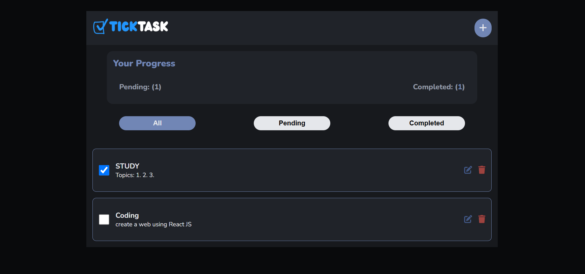

# TickTask
- A personal todo app for all your tasks, built using HTML, CSS and JavaScript. Keep your daily tasks in an organised way by adding, editing, deleting and tracking.

## Live Demo
[Visit Website](https://udayprakash999.github.io/TickTask)

## Project Screenshot

## About The Project

This webapp was created as a simple user-friendly and clean task management application. The goal of this app is to make it easy to organize daily tasks, be it coding realted or study related, and keep track of completed/pending work throughout the day.

Users can add new tasks, edit or delete current ones and tick them as completed. Filter between completed and pending work makes it clean to check task you have dinne and tasks that are yet to be done.

I learned and sharpend my JS skills in devlopment of this project, i leanred a lot about DOM manipulation, event listeners and working with Local storage.

## Features
- Add new tasks with a title and description.
- Edit current tasks.
- Delete tasks when they are no longer needed
- Mark tasks as completed using clean checkboxes
-Filter tasks in All, Pending, Completed
- Display total number of pending and completed tasks
- Save tasks using local storage
- Tasks remain saved even after refresing or closing the page.
- Interactive modal forms for adding and editing tasks
- Dynamic task rendering using JS

## Tech Stack

- HTML
- CSS
- JavaScript
- DOM Manipulation
- Browser Local Storage
- JavaScript Date Object
- Font Awesome Icons

## What i Learned

- Working with JS DOM manipulation
- Handling form submissions
- Creating, Updating, and Deleting objects in array
- using local storage to save data without backend
- Dynamically creating and updating HTML elements
- Improving problem-solving skills through a realistic app

## Author

**Uday Prakash Gupta**

- GitHub: [@udayprakash999](https://github.com/udayprakash999)